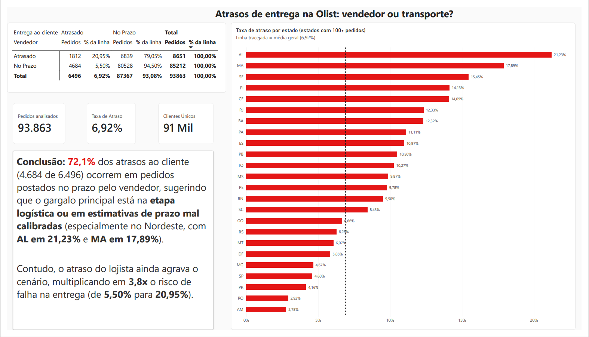

# Quem causa o atraso nas entregas da Olist: vendedor ou fase de transporte?

## Resultado
De **93.863 pedidos entregues** analisados, **6,9% (6.496)** chegaram depois da data prometida ao cliente. Em **72,1%** desses atrasos (4.684) o vendedor tinha cumprido o prazo de despacho, ou seja, o atraso apareceu na fase de transporte. Em **27,9%** (1.812) o vendedor também estourou o prazo.

Quando o vendedor atrasou o despacho, **20,9%** dos pedidos chegaram atrasados (1.812 de 8.651). Quando cumpriu o prazo, **5,5%** (4.684 de 85.212): cerca de **3,8 vezes** menos.

| Vendedor | Entrega ao cliente | Pedidos | % do total |
|---|---|---|---|
| No prazo | No prazo | 80.528 | 85,79% |
| No prazo | Atrasada | 4.684 | 4,99% |
| Atrasado | No prazo | 6.839 | 7,29% |
| Atrasado | Atrasada | 1.812 | 1,93% |

Dois pontos que parecem contraditórios e não são: a maior parte dos atrasos vem do grupo "vendedor no prazo" só porque ele é 91% dos pedidos; mas o risco **por pedido** é bem maior quando o vendedor atrasa. Também chama atenção que 6.839 pedidos tiveram o vendedor atrasado e mesmo assim chegaram no prazo: a data prometida absorveu a demora.

## Dashboard (Power BI)



O dashboard resume o resultado da análise SQL e acrescenta a visão por estado.
Arquivos: [`Olist_analise.pbix`](dashboard/Olist_analise.pbix) · [`dashboard_olist.pdf`](dashboard/dashboard_olist.pdf)

**Base:** 93.863 pedidos entregues (mesmos filtros da consulta SQL).

**O que ele mostra**
- **Matriz vendedor × entrega ao cliente:** 20,95% dos pedidos com vendedor atrasado chegam atrasados ao cliente, contra 5,50% quando o vendedor cumpre o prazo.
- **Taxa de atraso por estado** (apenas estados com 100+ pedidos, para evitar taxas instáveis): as maiores taxas estão no Nordeste (AL 21,23%, MA 17,89%, SE 15,45%, PI 14,13%, CE 14,09%), além de RJ (12,33%) e ES (10,97%). SP fica em 4,60%, abaixo da média geral de 6,92%.

**Cuidado na interpretação:** o dashboard mostra *onde* os atrasos se concentram, não *por quê*. Distância, malha logística e prazos estimados são hipóteses a testar, não conclusões.

## Recomendação
Dois focos.

1. **Despacho do vendedor.** É a etapa que a Olist consegue controlar mais diretamente (prazos, avisos, apoio ou penalidades para vendedores que atrasam), e pedidos com vendedor atrasado chegam atrasados cerca de 3,8 vezes mais. Mas esse foco atinge só parte do problema: em 72% dos atrasos o vendedor cumpriu o prazo. Numa estimativa grosseira, que supõe que o vendedor é a causa, igualar a taxa de atraso desses pedidos à dos vendedores no prazo evitaria cerca de um quinto dos atrasos.
2. **Fase de transporte.** Como 93% dos pedidos chegam no prazo, a data prometida não parece otimista no geral, mas pode ser em grupos específicos. Recomendo comparar, por **estado do cliente** e por **categoria de produto**, o tempo real de entrega com a data prometida, e ajustar o prazo onde os atrasos se repetem.

A base não permite afirmar a causa dos atrasos. Estes são pontos a investigar, não conclusões.

## Objetivo
Separar, nos pedidos entregues com atraso, quando o atraso nasce no vendedor (demora para despachar) e quando nasce depois do despacho, na fase de transporte.

## Dados
Dataset público [Brazilian E-Commerce Public Dataset by Olist](https://www.kaggle.com/datasets/olistbr/brazilian-ecommerce) (Kaggle), em SQLite, consultado no DB Browser. Tabelas usadas:
- `olist_orders_dataset`: pedidos e datas
- `olist_order_items_dataset`: itens, vendedor (`seller_id`) e prazo de envio do vendedor (`shipping_limit_date`)

## Como medi cada etapa
- **Vendedor:** compara o prazo de envio (`shipping_limit_date`) com a data em que o vendedor entregou ao transportador (`order_delivered_carrier_date`). Passou do prazo = vendedor atrasado.
- **Entrega ao cliente:** compara a data prometida (`order_estimated_delivery_date`) com a data real (`order_delivered_customer_date`), **somente o dia, sem a hora**. A data prometida vem sempre com `00:00:00`, e a de entrega traz a hora real; comparar com a hora marcava como atrasado um pedido entregue às 14h do dia prometido. Corrigir isso retirou **1.292 pedidos** que a regra antiga contava como atrasados (7.826 contra 6.534 em toda a base de entregues).
- **Como interpretei os grupos:**
  - Pedido atrasado e vendedor atrasado: atraso com participação do vendedor.
  - Pedido atrasado e vendedor no prazo: o atraso apareceu depois do despacho. Pode ser a transportadora ou uma data prometida otimista demais, e a base não separa as duas causas.
  - Pedido no prazo: sem atraso para o cliente.

## Limpeza dos dados
Filtros aplicados:
- Apenas pedidos com status `delivered`.
- Datas de aprovação, de despacho e de entrega ao cliente preenchidas.
- Despacho no mesmo momento ou depois da aprovação do pagamento.

| Etapa | Pedidos |
|---|---|
| Entregues com as datas preenchidas | 96.455 |
| Excluídos por despacho anterior à aprovação | 1.350 (1,40%) |
| Excluídos por terem itens de mais de um vendedor | cerca de 1.240 (1,3%) |
| **Analisados** | **93.863** |

Alguns pedidos tinham a data de despacho **anterior** à aprovação do pagamento. Não dá para saber a causa só com esta base (pode ser erro de registro ou aprovação registrada com atraso), e por isso trato como hipótese. Esses pedidos foram excluídos.

## Um pedido pode ter vários itens e vários vendedores
Um mesmo pedido (`order_id`) pode ter várias linhas na tabela de itens, cada uma com seu `shipping_limit_date`. Um JOIN direto duplicaria os pedidos, então agrupei os itens por pedido antes de juntar.

Excluí os pedidos com **mais de um vendedor** (cerca de 1,3% da base): a tabela de pedidos tem uma única data de entrega ao transportador, e com mais de um vendedor não dá para saber quem despachou, o que tornaria a atribuição do atraso ambígua. Nos pedidos que sobraram há um único vendedor, e usei `MAX(shipping_limit_date)` para consolidar os itens dele.

## Consulta final
```sql
SELECT
  status_vendedor,
  status_entrega_final,
  COUNT(*) AS total_pedidos,
  ROUND(100.0 * COUNT(*) / SUM(COUNT(*)) OVER (), 2) AS pct_do_total
FROM (
  SELECT
    o.order_id,
    CASE WHEN o.order_delivered_carrier_date > i.limite_vendedor_final
         THEN 'Atrasado' ELSE 'No Prazo' END AS status_vendedor,
    CASE WHEN date(o.order_delivered_customer_date) > date(o.order_estimated_delivery_date)
         THEN 'Atrasado' ELSE 'No Prazo' END AS status_entrega_final
  FROM olist_orders_dataset AS o
  JOIN (
    SELECT order_id, MAX(shipping_limit_date) AS limite_vendedor_final
    FROM olist_order_items_dataset
    GROUP BY order_id
    HAVING COUNT(DISTINCT seller_id) = 1
  ) AS i ON o.order_id = i.order_id
  WHERE o.order_status = 'delivered'
    AND o.order_approved_at IS NOT NULL
    AND o.order_delivered_carrier_date IS NOT NULL
    AND o.order_delivered_customer_date IS NOT NULL
    AND o.order_delivered_carrier_date >= o.order_approved_at
) AS base
GROUP BY status_vendedor, status_entrega_final;
```

## Limitações
- A base não informa o motivo de cada atraso. O resultado mostra **em que fase** o atraso apareceu, não **quem foi o responsável**.
- Pedidos com mais de um vendedor ficaram de fora.
- A comparação do vendedor usa o `shipping_limit_date` mais tardio do pedido.
- O dataset cobre um período específico e pode não representar a operação atual.

## Próximos passos
- Abrir os atrasos pós-despacho por **estado do cliente** e por **categoria de produto**, usando a **mediana** dos dias de atraso (e não a média, por causa de valores extremos).
- Comparar o tempo real de transporte com o planejado (data prometida menos prazo de envio do vendedor) para separar melhor a fase de transporte.
